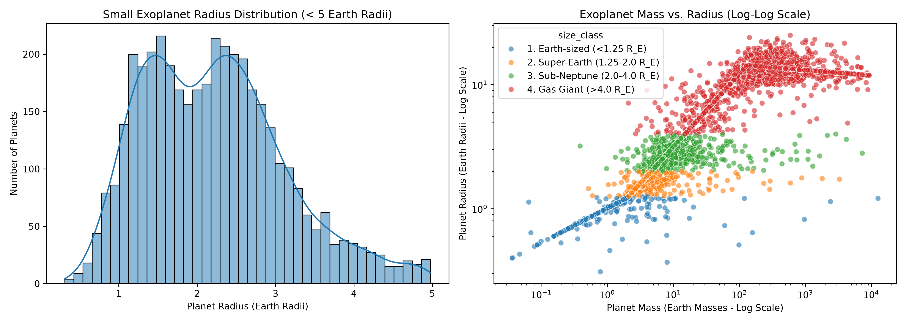

# NASA Exoplanet Archive — Exploratory Data Analysis

Exploratory analysis and SQLite pipeline examining the confirmed exoplanet catalog (**6,470 raw records $\rightarrow$ 6,019 complete physical records**) from the NASA Exoplanet Archive Composite Parameters (`pscomppars`) table.



## Project Overview

1. **Ingestion (`exoplanets_raw.csv`):** Queries 12 core columns from the NASA TAP API with local CSV caching.
2. **Cleaning (`exoplanets_clean.csv`):** Audits missing values and distribution skew, filtering for records with complete orbital period, radius, mass, and host star temperature measurements.
3. **Analysis & Feature Engineering:** Uses grouped medians to compare telescope selection biases (`Transit` vs. `Radial Velocity` vs. `Imaging`), derives bulk planet density (`density_gcc`), and bins worlds into 4 radius tiers (`size_class`).
4. **Visualization & SQLite (`exoplanets.db`):** Plots the Fulton Radius Valley and log-log Mass-Radius power law, then loads the cleaned table into SQLite to query nearby rocky exoplanets (`< 30 pc`).

## Key Findings

- **Selection Bias:** `Transit` discoveries (`n = 4,772` clean) have a median orbital period of `8.01` days and median mass of `6.98` Earths, whereas `Radial Velocity` discoveries (`n = 1,166` clean) have a median period of `319.70` days and median mass of `314.65` Earths (~1 Jupiter mass).
- **The `2.0` Earth-Radii Density Drop:** Median bulk density drops from `5.67 g/cm³` (Earth-sized) and `4.43 g/cm³` (Super-Earths) down to `2.31 g/cm³` (Sub-Neptunes) and `0.97 g/cm³` (Gas Giants) as planets above `2.0 R_E` retain volatile gas envelopes.
- **Radius Valley & Degeneracy Plateau:** Small planets (`< 5 R_E`) show a bimodal radius split around `1.8–2.0 R_E` from atmospheric stripping, while massive gas giants (`> 100 M_E`) plateau around `~11–13 R_E` due to gravitational compression.
- **Closest Rocky Neighbors (SQLite):** Filtering `exoplanets.db` for rocky worlds (`pl_rade <= 2.0 R_E`, `density_gcc >= 4.0 g/cm³`) within `30 pc` highlights `Proxima Cen d` and `Proxima Cen b` (`1.30 pc`) and the 4-planet `Barnard's Star` system (`1.83 pc`), all detected via `Radial Velocity`.

## Data Dictionary

| Column                | Description                                                                           | Units                     |
| :-------------------- | :------------------------------------------------------------------------------------ | :------------------------ |
| `pl_name`             | Planet identifier (1 row per planet)                                                  | Text                      |
| `hostname`            | Host star identifier                                                                  | Text                      |
| `discoverymethod`     | Detection technique (`Transit`, `Radial Velocity`, `Imaging`, etc.)                   | Text                      |
| `disc_year`           | Publication year of discovery                                                         | Year                      |
| `sy_snum` / `sy_pnum` | Number of stars / planets in the system                                               | Count                     |
| `pl_orbper`           | Orbital period                                                                        | Earth days                |
| `pl_rade`             | Planet radius                                                                         | Earth radii ($R_\oplus$)  |
| `pl_bmasse`           | Planet mass (best estimate)                                                           | Earth masses ($M_\oplus$) |
| `pl_eqt`              | Planet equilibrium temperature                                                        | Kelvin ($K$)              |
| `st_teff`             | Host star effective temperature                                                       | Kelvin ($K$)              |
| `sy_dist`             | Distance from Earth                                                                   | Parsecs ($\text{pc}$)     |
| `density_gcc`         | Engineered bulk density: $(M_\oplus / R_\oplus^3) \times 5.51$                        | $\text{g/cm}^3$           |
| `size_class`          | Engineered radius category (`Earth-sized`, `Super-Earth`, `Sub-Neptune`, `Gas Giant`) | Category                  |

## Setup & Usage

```bash
python -m venv venv
.\venv\Scripts\Activate.ps1
pip install -r requirements.txt
```
